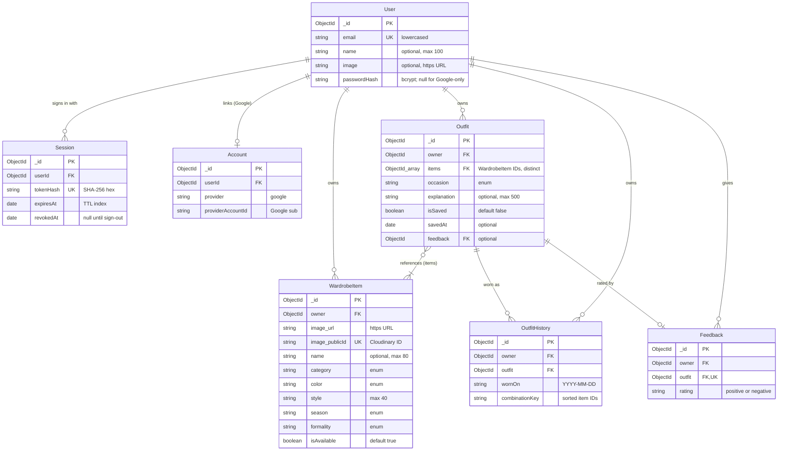
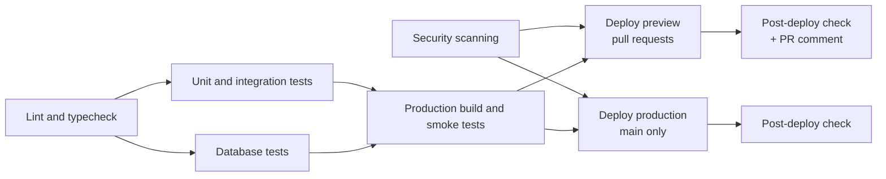

# ReWear AI

[](https://github.com/aarushikaushikk/RewearAI/actions/workflows/ci.yml)
[](https://github.com/aarushikaushikk/RewearAI/actions/workflows/codeql.yml)

> An intelligent stylist that creates new outfits from clothes you already own.

ReWear AI is a digital wardrobe application that helps users organize clothing they already own and generate occasion-based outfit combinations from those items, encouraging wardrobe reuse rather than new purchases.

**Team:** Aarushi Kaushik, Pranav Sirnapalli
**Course:** AI Coding, Project 2 / HW-3

## Status

The application is in `src/`. User Stories 1–7 and 11 are merged; the rest are tracked in [Sprint 4](https://github.com/aarushikaushikk/RewearAI/milestones). Every merge to `main` deploys to production (see [CI/CD and Deployment](#cicd-and-deployment)). The `baseline/` and `run-*` folders are separate prototypes from the [HW-3 Rules Experiment](#hw-3-rules-experiment).

## Core Features (planned)

- Authentication with private, user-specific wardrobe data
- Clothing image upload and AI-assisted classification (category, color, style, season, formality)
- Digital wardrobe: view, edit, search, filter, and remove items
- Availability management
- Occasion-based outfit generation (work, dinner, weekend, casual, formal)
- Alternative suggestions, saved outfits, and outfit history
- Recommendation explanations and feedback
- Graceful handling of upload, processing, and classification failures

Full requirements, the 15 user stories, and acceptance criteria are in [docs/PRD.md](docs/PRD.md).

## Repository Structure

```
RewearAI/
├── AGENTS.md                               # Rules file for AI coding tools
├── README.md
├── ReWear_HW3_Experiment_Comparison.pdf    # HW-3 before/after comparison
├── docs/
│   ├── PRD.md                              # Product requirements (15 user stories)
│   └── sprints/
│       ├── sprint-1/                       # planning.md, standups.md, retro.md
│       ├── sprint-2/
│       ├── sprint-3/
│       └── sprint-4/
├── baseline/                               # HW-3: shared starting point
├── run-a-no-rules/                         # HW-3: User Story 5 built WITHOUT rules
└── run-b-with-rules/                       # HW-3: User Story 5 built WITH rules
```

## Getting Started

### Prerequisites

| Need | Version or note |
|---|---|
| Node.js | 20.19 or later (Mongoose and `mongodb-memory-server` need it) |
| npm | Comes with Node.js |
| Git | Any recent version |
| MongoDB Atlas | A free cluster |
| Cloudinary | A free account, for clothing photos |
| Google Cloud | Optional, only for Google sign-in |
| Vercel and GitHub | Only for deploying |

### 1. Get the code and install packages

```bash
git clone https://github.com/aarushikaushikk/RewearAI.git
```

```bash
cd RewearAI
```

```bash
npm install
```

`npm install` also downloads the `mongod` binary the database tests use. To skip that download, set `MONGOMS_DISABLE_POSTINSTALL=1` first; `npm run test:db` then downloads it on first use.

### 2. Create your environment file

```bash
cp .env.example .env.local
```

`.env.local` is git-ignored. Never commit it, and never put real values in `.env.example`.

| Variable | Needed for | Local value |
|---|---|---|
| `MONGODB_URI` | Everything | Your Atlas connection string, with `/rewear` as the database (step 3) |
| `APP_ORIGIN` | Google sign-in; required in production | `http://localhost:3000`. Password sign-in also works with it empty |
| `TRUST_PROXY` | Per-client rate limits behind a proxy | `false` |
| `CLOUDINARY_CLOUD_NAME`, `CLOUDINARY_API_KEY`, `CLOUDINARY_API_SECRET` | Uploading clothing photos | From Cloudinary (step 4) |
| `CRON_SECRET` | The daily cleanup of abandoned uploads | A long random string (step 4) |
| `GOOGLE_CLIENT_ID`, `GOOGLE_CLIENT_SECRET` | Google sign-in (optional) | From Google Cloud (step 5) |

### 3. Set up MongoDB Atlas

1. Create a free cluster at [MongoDB Atlas](https://www.mongodb.com/cloud/atlas).
2. Under **Database Access**, add a database user with a strong password.
3. Under **Network Access**, add your IP address.
4. Click **Connect → Drivers** and copy the connection string.
5. Paste it into `MONGODB_URI`, filling in the user, password, and cluster host, and keep `/rewear` as the database name:

   ```
   MONGODB_URI=mongodb+srv://<username>:<password>@<cluster-host>/rewear?retryWrites=true&w=majority
   ```

The app creates its indexes the first time it connects, so an empty database needs no setup or migration.

### 4. Set up Cloudinary

1. Create a free account at [Cloudinary](https://cloudinary.com).
2. Under **Settings → API Keys**, copy the cloud name, API key, and API secret into the three `CLOUDINARY_*` variables.
3. Set `CRON_SECRET` to a long random string. This prints one:

   ```bash
   openssl rand -hex 32
   ```

Without Cloudinary settings the app still runs, but adding clothing fails.

### 5. Set up Google sign-in (optional)

1. In the [Google Cloud Console](https://console.cloud.google.com/apis/credentials), create an OAuth client of type **Web application**.
2. Add this authorized redirect URI, exactly: `http://localhost:3000/api/auth/google/callback`
3. Copy the client ID and secret into `GOOGLE_CLIENT_ID` and `GOOGLE_CLIENT_SECRET`, and set `APP_ORIGIN=http://localhost:3000`.

Without these, the Google button doesn't appear and email/password sign-in keeps working.

### 6. Start the app

```bash
npm run dev
```

Open http://localhost:3000, create an account on the sign-up page, and add a few clothing items from the Wardrobe page.

### Check your work

Run these before opening a pull request, along with the tests in [Running Tests](#running-tests). CI runs the same ones.

```bash
npm run lint
```

```bash
npm run typecheck
```

## Database

The app stores its data in MongoDB Atlas through Mongoose, in seven collections: User, Session, Account, WardrobeItem, Outfit, OutfitHistory, and Feedback. Every record belongs to one user, and every query is scoped to the signed-in user.

The connection helper is [src/lib/db.ts](src/lib/db.ts) (server-only). Route Handlers call `connectToDatabase()`, which reuses one cached connection and builds the required indexes on first connect. If the URI is missing or the connection fails, the helper logs only the error type on the server and throws a `DatabaseConnectionError` with a safe, generic message.

Every model has an `_id` (ObjectId) and Mongoose's `createdAt` and `updatedAt` timestamps. They're left out of the tables below.

### Diagram



GitHub renders the diagram on this page. Mermaid has no array or nested-object types, so `items` is shown as `ObjectId_array`, and the nested `image.url` and `image.publicId` as `image_url` and `image_publicId`.

### Ownership and privacy

Every record belongs to one user: `owner` on wardrobe, outfit, history, and feedback records, and `userId` on sessions and accounts. Repositories take the owner from the signed-in session, never from the request, and include it in every query, so one user can't read or change another's records ([AGENTS.md](AGENTS.md) §5 and §7).

### Collections

#### User ([User.ts](src/models/User.ts))

| Field | Type | Required | Rules |
|---|---|---|---|
| `email` | String | Yes | Unique, trimmed, lowercased, must look like an email |
| `name` | String | No | Trimmed, at most 100 characters |
| `image` | String | No | An `https://` URL |
| `passwordHash` | String | No | A bcrypt hash, never a plain password. `null` for Google-only users. Left out of queries unless selected explicitly |

#### Session ([Session.ts](src/models/Session.ts))

The browser holds a random token in the `HttpOnly` cookie `rewear_session`. MongoDB stores only its SHA-256 hash.

| Field | Type | Required | Rules |
|---|---|---|---|
| `userId` | ObjectId → User | Yes | Indexed |
| `tokenHash` | String | Yes | Unique, a 64-character SHA-256 hex digest |
| `expiresAt` | Date | Yes | 7 days after sign-in. A TTL index deletes the session once this passes |
| `revokedAt` | Date | No | Set on sign-out. A revoked session no longer signs anyone in |

#### Account ([Account.ts](src/models/Account.ts))

A Google identity linked to a user. Google's access and refresh tokens are never stored.

| Field | Type | Required | Rules |
|---|---|---|---|
| `userId` | ObjectId → User | Yes | |
| `provider` | String | Yes | `google` |
| `providerAccountId` | String | Yes | Google's `sub`, not the email |

Indexes: `{ provider, providerAccountId }` unique, so a Google identity belongs to one user; `{ userId, provider }` unique, so a retried sign-in can't add a second link.

#### WardrobeItem ([WardrobeItem.ts](src/models/WardrobeItem.ts))

| Field | Type | Required | Rules |
|---|---|---|---|
| `owner` | ObjectId → User | Yes | Indexed |
| `image.url` | String | Yes | An `https://` Cloudinary URL |
| `image.publicId` | String | Yes | Cloudinary public ID. Unique, so a retried save can't create a second item for one photo |
| `name` | String | No | Trimmed, at most 80 characters |
| `category` | String | Yes | `Top`, `Bottom`, `Outerwear`, `Dress`, `Shoes`, `Accessory` |
| `color` | String | Yes | `Black`, `White`, `Grey`, `Charcoal`, `Beige`, `Camel`, `Brown`, `Red`, `Burgundy`, `Pink`, `Orange`, `Yellow`, `Green`, `Blue`, `Navy`, `Indigo`, `Purple`, `Multicolor` |
| `style` | String | Yes | Free text, trimmed, at most 40 characters |
| `season` | String | Yes | `Spring`, `Summer`, `Autumn`, `Winter`, `All-season` |
| `formality` | String | Yes | `Casual`, `Smart casual`, `Formal` |
| `isAvailable` | Boolean | Yes | Default `true`. Only available items are used for new outfits |

The allowed values come from [src/types/wardrobe.ts](src/types/wardrobe.ts), which the forms and filters share.

#### Outfit ([Outfit.ts](src/models/Outfit.ts))

An outfit is created the first time a suggestion is saved, marked as worn, or rated. Later actions on the same clothes for the same occasion reuse it. It stores references to wardrobe items, never copies of their data.

| Field | Type | Required | Rules |
|---|---|---|---|
| `owner` | ObjectId → User | Yes | Indexed |
| `items` | ObjectId[] → WardrobeItem | Yes | At least one, no duplicates. Stored sorted, so the same clothes in any order match one outfit |
| `occasion` | String | Yes | `work`, `dinner`, `weekend`, `casual`, `formal` |
| `explanation` | String | No | Trimmed, at most 500 characters. A blank value is stored as none |
| `isSaved` | Boolean | Yes | Default `false`. `true` while it's on the Saved Outfits page |
| `savedAt` | Date | No | When it was last saved |
| `feedback` | ObjectId → Feedback | No | Set while the outfit has a rating |

Index: `{ owner, isSaved, savedAt: -1 }` for the Saved Outfits page, newest first.

Outfits are never deleted. If a wardrobe item is removed later, the outfit keeps its ID and the Saved Outfits and History pages show that item as no longer in the wardrobe.

#### OutfitHistory ([OutfitHistory.ts](src/models/OutfitHistory.ts))

One record each time a user marks an outfit as worn.

| Field | Type | Required | Rules |
|---|---|---|---|
| `owner` | ObjectId → User | Yes | |
| `outfit` | ObjectId → Outfit | Yes | Must be the owner's own outfit |
| `wornOn` | String | Yes | A calendar date, `YYYY-MM-DD` |
| `combinationKey` | String | Yes | The outfit's item IDs, sorted and lowercased |

Indexes:
- `{ outfit, wornOn }` unique: a retried "mark as worn" can't add a second record.
- `{ owner, wornOn, combinationKey }` unique: the same clothes on the same day are one wear, even through different outfit records.
- `{ owner, wornOn: -1 }`: the History page, most recent first.

#### Feedback ([Feedback.ts](src/models/Feedback.ts))

A user's rating of an outfit suggestion.

| Field | Type | Required | Rules |
|---|---|---|---|
| `owner` | ObjectId → User | Yes | Indexed |
| `outfit` | ObjectId → Outfit | Yes | Unique: changing a rating updates this record, and a retry can't add a second one |
| `rating` | String | Yes | `positive` or `negative` |

Clearing a rating deletes the record and unsets `Outfit.feedback`.

### Indexes

[src/lib/repositories/mongoIndexes.ts](src/lib/repositories/mongoIndexes.ts) builds every index above when the app first connects to a database, and retries if that fails. The unique indexes are what stop duplicate emails, sessions, account links, wardrobe items, wear records, and ratings, so writes don't rely on Mongoose's background index build. A new, empty database needs no migration.

### Databases

| Environment | Database |
|---|---|
| Local development and Vercel Preview | `rewear` |
| Vercel Production | `rewear-prod` |
| Tests | A temporary `mongodb-memory-server`, never Atlas |

The database name is the path in `MONGODB_URI`.

## Authentication

People sign in with an email and password or with Google. Both issue the same session: a random token in an `HttpOnly` cookie, with only its SHA-256 hash stored in MongoDB, so sessions can be revoked on the server.

Google sign-in needs `GOOGLE_CLIENT_ID`, `GOOGLE_CLIENT_SECRET`, and `APP_ORIGIN`; [step 5 of Getting Started](#5-set-up-google-sign-in-optional) shows how to create the OAuth client. Without them, the Google option doesn't appear and password sign-in keeps working.

A Google sign-in never connects to an existing account because the email matches. It's refused, and that person signs in the way they did before. [AGENTS.md](AGENTS.md) §7 has the security rules.

## Image Storage (Cloudinary)

Clothing photos are stored in Cloudinary; MongoDB keeps only the image URL and public ID. The adapter is [src/lib/images/cloudinaryImageStore.ts](src/lib/images/cloudinaryImageStore.ts) (server-only); tests use an in-memory store and never contact Cloudinary. [Step 4 of Getting Started](#4-set-up-cloudinary) shows where to find the keys.

Uploads accept JPEG, PNG, or WebP up to 4 MB; the browser shrinks photos to 2000 px before uploading. Each image goes to `rewear/users/<userId>/` tagged `rewear-pending`. A daily Vercel Cron job ([vercel.json](vercel.json)) calls `/api/cron/cleanup-uploads`, which deletes pending images older than 24 hours that no wardrobe item uses, so abandoned uploads are removed within about 48 hours.

Both upload routes require a signed-in session (`requireAuth()`) and a same-origin request (`validateCsrfOrigin()`), like the auth routes. The cron route instead requires `Authorization: Bearer $CRON_SECRET`.

## Running Tests

| Command | What it runs | Database |
|---|---|---|
| `npm test` | Unit, component, and integration tests | None; `MONGODB_URI` is blanked |
| `npm run test:db` | Real-database tests in `tests/db/` | A temporary MongoDB server on `127.0.0.1` |
| `npm run test:smoke` | Builds the app and tests `next start` with real requests | A temporary MongoDB server on `127.0.0.1` |

`npm run test:db` and `npm run test:smoke` never use `MONGODB_URI` or Google settings from your shell or `.env.local`, and no test contacts Google: they use a local fake. [tests/helpers/mongoTestServer.ts](tests/helpers/mongoTestServer.ts) starts a new server for each test file, refuses any other database, and removes the server's files when it stops. If the server can't start, the tests fail rather than falling back to another database.

`npm install` downloads the `mongod` binary these tests use. Set `MONGOMS_DISABLE_POSTINSTALL=1` to skip that download where the tests don't run; `npm run test:db` will then download it on first use.

The browser checks in `npm run test:smoke` run only when `SMOKE_CHROME_PATH` points to a Chrome executable, as it does in CI. On a Mac:

```bash
SMOKE_CHROME_PATH="/Applications/Google Chrome.app/Contents/MacOS/Google Chrome" npm run test:smoke
```

## CI/CD and Deployment

- **Production:** https://rewear-ai-app.vercel.app
- **Preview (latest PR):** https://rewear-ai-preview.vercel.app

GitHub Actions runs every check and owns every deploy. Vercel's own Git deploys are off (`"git": { "deploymentEnabled": false }` in [vercel.json](vercel.json)), so nothing reaches Vercel unless the whole pipeline has passed.

### Pipeline

[.github/workflows/ci.yml](.github/workflows/ci.yml) runs on every pull request to `main` and every push to `main`. A newer run on the same branch cancels an older one.



| Stage | Job | What it does |
|---|---|---|
| 1. Quality | Lint and typecheck | `npm run lint`, `npm run typecheck` |
| 2. Tests | Unit and integration tests | `npm test` (Vitest; `MONGODB_URI` is forced empty, so it can't reach a real database) |
| 2. Tests | Database tests | `npm run test:db` against a temporary `mongodb-memory-server`, cached between runs |
| 3. Build | Production build and smoke tests | `npm run test:smoke`: `next build`, then HTTP and real-Chrome checks against the built app and a temporary database. Fails if any `/api` route isn't dynamic (`ƒ`) |
| Security | Security scanning | `npm audit` of production dependencies (fails on high), GitHub dependency review on PRs (fails on high), and a gitleaks secret scan of the full history |
| Security | CodeQL ([codeql.yml](.github/workflows/codeql.yml)) | `security-extended` analysis of the TypeScript code on PRs, on pushes to `main`, and weekly. Results appear under Security → Code scanning |
| 4. Deploy | Deploy preview | PRs only. `vercel pull`, `vercel build`, `vercel deploy --prebuilt`, then points the fixed preview domain at the new deployment and comments both URLs on the PR |
| 4. Deploy | Deploy production | Pushes to `main` only, one at a time. Same steps with `--prod` |
| 5. Verify | Post-deploy check | [scripts/checkDeployment.sh](scripts/checkDeployment.sh): `/sign-in` must return 200 and `/api/auth/session` must not return a 5xx |

[Dependabot](.github/dependabot.yml) opens weekly PRs for npm and GitHub Actions updates. Major versions are ignored, because AGENTS.md requires both partners to agree to those.

The third-party gitleaks action is pinned to a full commit SHA, with its version in a comment, because a tag can be moved to different code. Dependabot updates the pin. GitHub's own `actions/*` use version tags.

### Reading a run

- **Summary:** each run's page (Actions → the run) lists the test counts for each suite and, after a deploy, its URL and database.
- **Diagnostics:** if the build and smoke tests fail, the run has a `smoke-diagnostics` artifact (kept for 7 days) with the full build output and the browser screenshots taken so far.
- **Timeouts:** every job has a `timeout-minutes` limit (10–20 minutes), so a hung browser or database stops in minutes instead of GitHub's 6-hour default.

### Environments

| Environment | Where it runs | Config | Database |
|---|---|---|---|
| Development | `npm run dev` | `.env.local` | `rewear` |
| Test | Vitest and CI | Set by the test configs | Temporary `mongodb-memory-server`, never Atlas |
| Preview | Vercel Preview, one deploy per PR push | Vercel Preview environment variables | `rewear` (holds the seeded test account) |
| Production | Vercel Production, every merge to `main` | Vercel Production environment variables | `rewear-prod` |

Preview and Production are also GitHub Environments, so each deploy is listed on the repository's Deployments page with its URL.

Preview and Production use the same Atlas cluster and user, with different databases. The app creates its indexes when it connects, so a new, empty database needs no migration.

`APP_ORIGIN` must be one exact origin (sign-in refuses any other). Each preview deploy has its own URL, so the pipeline also points a fixed domain, `PREVIEW_DOMAIN`, at the latest preview, and Preview's `APP_ORIGIN` is that domain. Sign in through the domain in the PR comment, not the per-deployment URL. The latest PR push takes over the domain.

### Settings the pipeline needs

| Name | Kind | Value |
|---|---|---|
| `VERCEL_TOKEN` | GitHub secret | A Vercel access token |
| `VERCEL_ORG_ID` | GitHub secret | `orgId` from `.vercel/project.json` |
| `VERCEL_PROJECT_ID` | GitHub secret | `projectId` from `.vercel/project.json` |
| `PREVIEW_DOMAIN` | GitHub variable | e.g. `rewear-ai-preview.vercel.app` |
| `PRODUCTION_URL` | GitHub variable | e.g. `https://rewear-ai-app.vercel.app` |

A deploy job fails with a message naming any of these that is missing.

### One-time setup

1. Log in and create the Vercel project from the repository root:
   ```bash
   npx vercel@65.2.0 login
   ```
   ```bash
   npx vercel@65.2.0 link
   ```
   Choose to create a new project. This writes `.vercel/project.json`, which is gitignored.
2. Choose two unused `*.vercel.app` names: one for production (e.g. `rewear-ai-app.vercel.app`) and one for previews (e.g. `rewear-ai-preview.vercel.app`). You don't add them in the dashboard: each deploy job points its domain at the new deployment through the Vercel API ([scripts/setVercelAlias.sh](scripts/setVercelAlias.sh)).
3. In Vercel → Project → **Settings → Environment Variables**, add each variable below. For each one, untick **Development**, and tick **Preview** or **Production** only, as shown. Copy the values from `.env.local`; never commit them.

   | Variable | Preview | Production |
   |---|---|---|
   | `MONGODB_URI` | The value from `.env.local` (database `rewear`) | The same value, with the database path `/rewear` changed to `/rewear-prod` |
   | `APP_ORIGIN` | `https://<preview domain>` | `https://<production domain>` |
   | `TRUST_PROXY` | `true` | `true` |
   | `MONGOMS_DISABLE_POSTINSTALL` | `1` | `1` |
   | `CLOUDINARY_CLOUD_NAME`, `CLOUDINARY_API_KEY`, `CLOUDINARY_API_SECRET` | From `.env.local` | From `.env.local` |
   | `CRON_SECRET` | From `.env.local` | From `.env.local` |
   | `GOOGLE_CLIENT_ID`, `GOOGLE_CLIENT_SECRET` | From `.env.local`, if set | From `.env.local`, if set |

   Changes apply to the next deploy, so after editing a variable, rerun the deploy job.
4. In GitHub → **Settings → Secrets and variables → Actions**:
   - **Secrets** tab: add `VERCEL_ORG_ID` and `VERCEL_PROJECT_ID`, using `orgId` and `projectId` from `.vercel/project.json`.
   - **Variables** tab: add `PREVIEW_DOMAIN` (e.g. `rewear-ai-preview.vercel.app`, no `https://`) and `PRODUCTION_URL` (e.g. `https://rewear-ai-app.vercel.app`).
5. Create a token at Vercel → Account Settings → Tokens, then paste it when prompted:
   ```bash
   gh secret set VERCEL_TOKEN
   ```
6. In Vercel → Project → Settings → Deployment Protection, turn off Vercel Authentication. Otherwise previews return 401 to the post-deploy check, your partner and the graders.
7. In the Google OAuth client, add both redirect URIs: `https://<production domain>/api/auth/google/callback` and `https://<preview domain>/api/auth/google/callback`.
8. In Atlas → Network Access → IP Access List, add `0.0.0.0/0` (not temporary). Vercel's servers have no fixed IP addresses; the database user and password still protect the cluster.
9. After the first green run, protect `main` (Settings → Branches): require a pull request with one approval, and require the checks Lint and typecheck, Unit and integration tests, Database tests, Production build and smoke tests, Security scanning, and CodeQL.

### Verify a deploy

The pipeline checks that `/sign-in` loads and `/api/auth/session` doesn't fail. After a production deploy, also check by hand:

- [ ] Sign up, sign out, and sign in again with email and password
- [ ] Sign in with Google, if it's configured
- [ ] Add a clothing item with a photo; it appears in the wardrobe
- [ ] Reload the page and sign in again; the item is still there
- [ ] Generate an outfit, then save it and mark it as worn; it appears on Saved Outfits and History

### Roll back

In Vercel → Deployments, open an earlier production deployment and choose **Promote to Production**. Then revert the bad commit on `main` through a PR, so the next deploy doesn't bring it back.

## Troubleshooting

| Problem | Likely cause and fix |
|---|---|
| Sign-up, sign-in, or sign-out returns 403 | `APP_ORIGIN` doesn't match the address in the browser exactly. Use the fixed domain, not a per-deployment Vercel URL |
| "We couldn't reach the database" | Atlas **Network Access** doesn't allow your IP (or `0.0.0.0/0` for Vercel), or `MONGODB_URI` has the wrong user or password |
| The Google button is missing | `GOOGLE_CLIENT_ID` or `GOOGLE_CLIENT_SECRET` isn't set |
| Google says `redirect_uri_mismatch` | The OAuth client is missing `<APP_ORIGIN>/api/auth/google/callback` for this environment |
| Adding clothing fails | A `CLOUDINARY_*` variable is missing or wrong. Photos must be JPEG, PNG, or WebP, up to 4 MB |
| The cleanup route refuses requests | `CRON_SECRET` isn't set in that Vercel environment |
| Previews return 401 | Vercel Authentication is still on under Deployment Protection |
| A changed Vercel variable has no effect | Variables apply to the next deploy. Rerun the deploy job |

## HW-3 Rules Experiment

To test whether our rules file makes a measurable difference, we built the same feature twice with Claude Code in VS Code: once without rules and once with them.

**Feature tested:** [User Story 5 - Search and Filter (#10)](https://github.com/aarushikaushikk/RewearAI/issues/10)

> As a user, I want to search and filter my clothing so that I can quickly find specific items.

This was a **throwaway prototype** built on a hardcoded 12-item dummy wardrobe (`data/clothing.ts`), with no database, authentication, or image upload. It isn't the real implementation of User Story 5, so #10 stays in the backlog for its scheduled sprint.

| Folder | What it is |
|--------|------------|
| [`baseline/`](baseline) | Shared starting point: Next.js 16.4.3 / React 19.3 / TypeScript scaffold, plus the dummy clothing data and `ClothingItem` type. Both runs started from this. |
| [`run-a-no-rules/`](run-a-no-rules) | **Run A:** fresh chat, no `AGENTS.md` or PRD, brief feature description only. |
| [`run-b-with-rules/`](run-b-with-rules) | **Run B:** same prompt, clean start, with `AGENTS.md` and `docs/PRD.md` in place. |

### What changed between the runs

| | Run A (no rules) | Run B (with rules) |
|---|---|---|
| Filtering logic | `lib/filterClothing.ts` | `services/filterClothing.ts` (matches the `services/` domain-logic folder in `AGENTS.md`) |
| UI components | One `WardrobeBrowser.tsx` (163 lines) | `WardrobeBrowser.tsx` (121 lines) plus a separate `ClothingCard.tsx` |
| Tests | None | `services/filterClothing.test.ts`: 12 unit tests, all passing |
| Project docs in the run | None | `AGENTS.md` and `docs/PRD.md` |

The full comparison (code quality, design intent, naming, and architecture, with screenshots) is in [ReWear_HW3_Experiment_Comparison.pdf](ReWear_HW3_Experiment_Comparison.pdf).

### Running a prototype locally

Each folder is a standalone Next.js app. Run one at a time, since they all use port 3000:

```bash
cd run-b-with-rules
npm install
npm run dev
```

Then open http://localhost:3000. Swap in `baseline` or `run-a-no-rules` to see the others.

Run B's unit tests use Node's built-in test runner (Node 23.6+ for direct TypeScript support):

```bash
cd run-b-with-rules
node --test services/filterClothing.test.ts
```

## Rules File

[AGENTS.md](AGENTS.md) is the shared rules file every AI coding tool reads. It covers:

- **Project context:** sources of truth (PRD, design, the assigned issue), approved tech stack, architecture, naming and coding conventions
- **Product invariants:** never recommend clothing the user doesn't own, exclude unavailable items, keep data private
- **Database, images, auth, privacy, and security** rules
- **UI, mockups, and accessibility** requirements
- **Scrum workflow:** branch naming, commit format, PR and review rules
- **TDD, quality gates, CI/CD, and deployment**, plus how the agent should work

## Tech Stack

As defined in `AGENTS.md`. The HW-3 prototypes use only Next.js, React, and TypeScript.

| Layer | Choice |
|-------|--------|
| Frontend | Next.js, React, TypeScript, Tailwind CSS |
| Backend | Next.js Route Handlers (`app/api`) |
| Database | MongoDB Atlas with Mongoose |
| Image storage | Cloudinary |
| Authentication | Custom MongoDB-backed sessions; bcrypt for passwords; `openid-client` for Google |
| Testing | Vitest (unit/integration), Playwright (end-to-end) |
| Quality | ESLint, Prettier, TypeScript type checking |
| Hosting | Vercel |

## Project Management

Work is tracked on GitHub using Scrum:

- **Project board:** [ReWear AI Sprint Board](https://github.com/users/aarushikaushikk/projects/4), in Board layout with the columns **Backlog → Sprint Todo → In Progress → In Review → Done**, plus a view for each sprint.
- **Issues:** [23 issues](https://github.com/aarushikaushikk/RewearAI/issues), covering the 5 HW-3 tasks, the 15 PRD user stories, and a test-and-deploy task for each feature sprint. Each issue has its acceptance criteria as a checklist, labels, an estimate, and a milestone.
- **Labels:** `feature`, `bug`, `chore`, `docs`, `priority: high`, `priority: medium`, `priority: low`
- **Milestones:** [one per sprint](https://github.com/aarushikaushikk/RewearAI/milestones)

| Sprint | Due | Scope |
|--------|-----|-------|
| Sprint 1 | Fri Oct 30 | HW-3 tasks (#1–#5) |
| Sprint 2 | Wed Nov 4 | User Stories 1–5 (#6–#10), test and deploy (#23) |
| Sprint 3 | Sat Nov 7 | User Stories 6–9 (#11–#14), test and deploy (#24) |
| Sprint 4 | Wed Nov 11 | User Stories 10–15 (#15–#20), test and deploy (#25) |

Each sprint folder in [docs/sprints/](docs/sprints) holds its `planning.md` (goal, committed issues, estimates, PO/SM), `standups.md`, and `retro.md`.

## Team Workflow

- **Roles:** Product Owner and Scrum Master are recorded in each sprint's `planning.md`.
- **Sync:** Weekly on Microsoft Teams, Fridays at 5 PM; contact between meetings for anything blocking.
- **Branches:** One per issue, e.g. `feature/42-description`, `fix/57-description`, `chore/63-description`.
- **Commits:** Reference the issue, e.g. `feat: add wardrobe upload (#42)`.
- **Pull requests:** Link the issue (`Closes #42`), summarize the changes, describe testing, and get a partner's review before merging. Nothing goes directly to `main`.

## HW-3 Deliverables

- [x] GitHub repository: https://github.com/aarushikaushikk/RewearAI
- [x] Scrum board, milestones, and 10+ issues with acceptance criteria: [project board](https://github.com/users/aarushikaushikk/projects/4)
- [x] Rules file: [AGENTS.md](AGENTS.md)
- [x] PRD: [docs/PRD.md](docs/PRD.md)
- [x] Before/after comparison: [ReWear_HW3_Experiment_Comparison.pdf](ReWear_HW3_Experiment_Comparison.pdf)
- [ ] Reflection: _link to be added_
- [x] Sprint 1 standups: [docs/sprints/sprint-1/standups.md](docs/sprints/sprint-1/standups.md)
