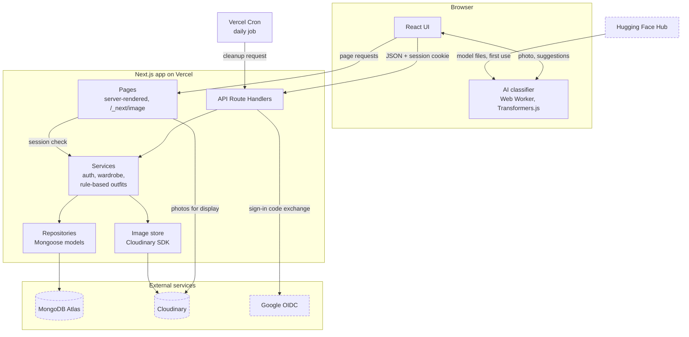

# ReWear AI System Architecture

ReWear AI is one Next.js 16 application. The same codebase renders the pages, runs the API Route Handlers, and ships the browser code. There are no separate backend services. The server talks to three external services: MongoDB Atlas, Cloudinary, and Google. The browser downloads one machine-learning model from the Hugging Face Hub and runs it locally. No AI API is called from the server.

Dashed boxes are external services we don't run. Everything inside "Next.js app on Vercel" is our code. "Image store" is our wrapper around the Cloudinary SDK, and "Cloudinary" is the hosted service it calls.

To keep the diagram readable, a few interactions are described below rather than drawn:
- the browser's redirect to Google and back during sign-in;
- `proxy.ts`, which redirects page visits that have no session cookie;
- the browser's Cache Storage for the model files;
- the stylist note reading outfit photos from Cloudinary.

## Frontend

The UI is React 19 with Tailwind CSS, in `src/app` (pages) and `src/components`. Pages are server-rendered shells. Each private page checks the session on the server, then its client components load and change data with `fetch` calls to `/api/*`. The browser sends the `rewear_session` cookie and an `Origin` header with these calls.

Some work happens entirely in the browser:

- **Wardrobe search and filter** (`src/services/filterWardrobeItems.ts`) runs over the list returned by `GET /api/wardrobe`.
- **Photo resizing** (`src/lib/images/resizeImage.ts`) shrinks a photo to at most 2,000 px and re-encodes it as JPEG before upload, which also drops EXIF data.
- **Clothing classification** and the **stylist note**: see [Clothing classification](#clothing-classification).
- **Explanation text.** The "Why these items?" panel turns the server's explanation facts into sentences.

## Backend

The backend is the Route Handlers in `src/app/api`. Each one is a few lines that call a handler in `src/lib`. Handlers check in this order:

1. the request origin, for state-changing methods;
2. the session (`requireAuth()`);
3. the request body.

They then call a service and return a fixed JSON envelope.

Business rules live in `src/services`. Examples are the outfit rules, which items a user owns, and how retries avoid duplicates. Services reach the database through repository interfaces (`src/lib/repositories`). Each interface has a MongoDB implementation and an in-memory one used by the tests. Repositories scope every query to the signed-in user, and another user's record looks the same as a missing one.

The full endpoint list is in `docs/API.md` and `docs/openapi.yaml`, added by the API documentation PR.

## Authentication

- **Email and password.** Passwords are hashed with bcryptjs. Signing in creates a random 32-byte session token. The browser gets it in the HttpOnly `rewear_session` cookie (`SameSite=Lax`, 7 days). MongoDB stores only its SHA-256 hash in `sessions`. There are no JWT sessions.
- **Google.** `openid-client` 6 runs OpenID Connect with PKCE, `state`, and `nonce`. These are kept in a short-lived, sealed, HttpOnly transaction cookie.
  1. The browser is redirected to Google and back to `/api/auth/google/callback`.
  2. The server exchanges the code and verifies the ID token.
  3. It identifies the user by Google's `sub`, and requires a verified email.
  4. It then issues the same kind of session cookie.

  A Google account is never linked to an existing account because the emails match.
- **Where the session is checked.** `src/proxy.ts` only redirects page visits that have no cookie at all, as a routing hint. The real check happens on the server for every private page (`requirePageSession()`) and every API call (`requireAuth()`). Both look the session up in MongoDB.

## Database and image storage

- **MongoDB Atlas, through Mongoose** (`src/lib/db.ts`, models in `src/models`). It stores users, sessions, Google account links, wardrobe items, outfits, outfit history, and feedback. Each record belongs to one user. Before a repository first uses a database, `ensureRequiredIndexes()` builds the indexes, once per database. The unique ones stop duplicates, such as two items for one photo or two history entries for the same clothes on the same day.
- **Cloudinary** stores the photos. MongoDB keeps each photo's URL and `publicId`.
  - Uploads go to `rewear/users/<userId>/` and are tagged `rewear-pending`.
  - Saving an item checks the photo with Cloudinary again before writing the record.
  - Deleting an item removes the photo first.

  The browser never talks to Cloudinary to upload. The server's image optimization fetches the original photos for display.

## Clothing classification

Classification runs in the user's browser, in a Web Worker (`src/services/classification/browser`).

- It uses Transformers.js with the `Marqo/marqo-fashionSigLIP` model for zero-shot scoring.
- The model files are downloaded from the Hugging Face Hub on first use, then served from the browser's Cache Storage.
- When a photo is chosen on Add Clothing, the worker scores the resized photo while the upload runs. Its suggestions fill only the fields the user hasn't touched.
- Uncertain values must be confirmed, and every failure leaves manual entry available.
- Nothing about the photo is sent to a model on the server.

The stylist note on Create Outfit is written in the browser from the outfit's facts (`src/services/stylist`). If the classifier model is already cached, the note also scores the outfit's photos with it. It never starts the model download itself.

## Outfit recommendation

`POST /api/outfits/generate` runs `OutfitRecommendationService` on the server. It is rule-based, with no model involved.

1. It loads the user's **available** items, and any outfits the user rated negative for that occasion.
2. `generateOutfit` (`src/services/outfits`) builds a top and bottom, or a dress, plus optional extras. It applies these rules:
   - formality allowed for the occasion;
   - compatible seasons;
   - prefer shoes when suitable ones exist;
   - avoid combinations already shown, which is how "Try another" works;
   - offer disliked combinations last;
   - prefer calmer colour palettes.
3. The response carries the items, the facts behind the choice (`explainOutfit`), and the user's saved rating for that outfit. If no outfit is possible, it says why.

Generated outfits aren't stored. An `Outfit` record is created only when the user saves the outfit, marks it as worn, or rates it. The same items for the same occasion are reused as one record, and history and feedback point to that record.

## Deployment and scheduled jobs

The app is built for Vercel, as listed in the README's stack table and configured by `vercel.json`. Configuration comes from environment variables (`.env.example` lists them):
- `MONGODB_URI`, `APP_ORIGIN`, `TRUST_PROXY`;
- the Cloudinary credentials;
- `CRON_SECRET`;
- the Google client ID and secret.

`vercel.json` schedules one Vercel Cron job, every day at 04:00 UTC. It calls `GET /api/cron/cleanup-uploads` with `Authorization: Bearer <CRON_SECRET>`. The job:
- removes the pending tag from uploads more than 24 hours old that a wardrobe item now uses;
- deletes the rest.

So abandoned photos are gone within about 48 hours.

The automated CI/CD pipeline with preview and production deploys is in PR #47 and isn't part of `main` yet. This diagram shows only what `main` contains.
