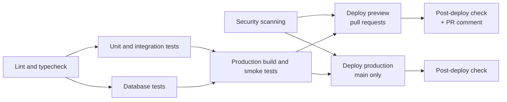

# CI/CD and Deployment

GitHub Actions runs every check and owns every deploy. Vercel's own Git deploys are off (`"git": { "deploymentEnabled": false }` in [vercel.json](../vercel.json)), so nothing reaches Vercel unless the whole pipeline has passed.

## Pipeline

[.github/workflows/ci.yml](../.github/workflows/ci.yml) runs on every pull request to `main` and every push to `main`. A newer run on the same branch cancels an older one.



| Stage | Job | What it does |
|---|---|---|
| 1. Quality | Lint and typecheck | `npm run lint`, `npm run typecheck` |
| 2. Tests | Unit and integration tests | `npm test` (Vitest; `MONGODB_URI` is forced empty, so it can't reach a real database) |
| 2. Tests | Database tests | `npm run test:db` against a temporary `mongodb-memory-server`, cached between runs |
| 3. Build | Production build and smoke tests | `npm run test:smoke`: `next build`, then HTTP and real-Chrome checks against the built app and a temporary database. Fails if any `/api` route isn't dynamic (`ƒ`) |
| Security | Security scanning | `npm audit` of production dependencies (fails on high), GitHub dependency review on PRs (fails on high), and a gitleaks secret scan of the full history |
| Security | CodeQL ([codeql.yml](../.github/workflows/codeql.yml)) | `security-extended` analysis of the TypeScript code on PRs, on pushes to `main`, and weekly. Results appear under Security → Code scanning |
| 4. Deploy | Deploy preview | PRs only. `vercel pull`, `vercel build`, `vercel deploy --prebuilt`, then points the fixed preview domain at the new deployment and comments both URLs on the PR |
| 4. Deploy | Deploy production | Pushes to `main` only, one at a time. Same steps with `--prod` |
| 5. Verify | Post-deploy check | [scripts/checkDeployment.sh](../scripts/checkDeployment.sh): `/sign-in` must return 200 and `/api/auth/session` must not return a 5xx |

[Dependabot](../.github/dependabot.yml) opens weekly PRs for npm and GitHub Actions updates. Major versions are ignored, because AGENTS.md requires both partners to agree to those.

## Environments

| Environment | Where it runs | Config | Database |
|---|---|---|---|
| Development | `npm run dev` | `.env.local` | `rewear` |
| Test | Vitest and CI | Set by the test configs | Temporary `mongodb-memory-server`, never Atlas |
| Preview | Vercel Preview, one deploy per PR push | Vercel Preview environment variables | `rewear` (holds the seeded test account) |
| Production | Vercel Production, every merge to `main` | Vercel Production environment variables | `rewear-prod` |

Preview and Production are also GitHub Environments, so each deploy is listed on the repository's Deployments page with its URL.

Preview and Production use the same Atlas cluster and user, with different databases. The app creates its indexes when it connects, so a new, empty database needs no migration.

`APP_ORIGIN` must be one exact origin (sign-in refuses any other). Each preview deploy has its own URL, so the pipeline also points a fixed domain, `PREVIEW_DOMAIN`, at the latest preview, and Preview's `APP_ORIGIN` is that domain. Sign in through the domain in the PR comment, not the per-deployment URL. The latest PR push takes over the domain.

## Settings the pipeline needs

| Name | Kind | Value |
|---|---|---|
| `VERCEL_TOKEN` | GitHub secret | A Vercel access token |
| `VERCEL_ORG_ID` | GitHub secret | `orgId` from `.vercel/project.json` |
| `VERCEL_PROJECT_ID` | GitHub secret | `projectId` from `.vercel/project.json` |
| `PREVIEW_DOMAIN` | GitHub variable | e.g. `rewear-ai-preview.vercel.app` |
| `PRODUCTION_URL` | GitHub variable | e.g. `https://rewear-ai-app.vercel.app` |

A deploy job fails with a message naming any of these that is missing.

## One-time setup

1. Log in and create the Vercel project from the repository root:
   ```bash
   npx vercel@65.2.0 login
   ```
   ```bash
   npx vercel@65.2.0 link
   ```
   Choose to create a new project. This writes `.vercel/project.json`, which is gitignored.
2. Copy `.env.local` into Vercel and store the IDs and domains in GitHub. Pass two unused `*.vercel.app` names, one for production and one for previews. Nothing needs adding in the Vercel dashboard: each deploy job points its domain at the new deployment with `vercel alias set`.
   ```bash
   bash scripts/setupVercelEnv.sh rewear-ai-app.vercel.app rewear-ai-preview.vercel.app
   ```
   Production gets the same `MONGODB_URI` with the database changed to `rewear-prod`. Each environment gets its own `APP_ORIGIN`, plus `TRUST_PROXY=true` and `MONGOMS_DISABLE_POSTINSTALL=1`. No value is printed.
3. Create a token at Vercel → Account Settings → Tokens, then paste it when prompted:
   ```bash
   gh secret set VERCEL_TOKEN
   ```
4. In Vercel → Project → Settings → Deployment Protection, turn off Vercel Authentication. Otherwise previews return 401 to the post-deploy check, your partner and the graders.
5. In the Google OAuth client, add both redirect URIs: `https://<production domain>/api/auth/google/callback` and `https://<preview domain>/api/auth/google/callback`.
6. After the first green run, protect `main` (Settings → Branches): require a pull request with one approval, and require the checks Lint and typecheck, Unit and integration tests, Database tests, Production build and smoke tests, Security scanning, and CodeQL.

## Rollback

In Vercel → Deployments, open an earlier production deployment and choose **Promote to Production**. Then revert the bad commit on `main` through a PR, so the next deploy doesn't bring it back.
