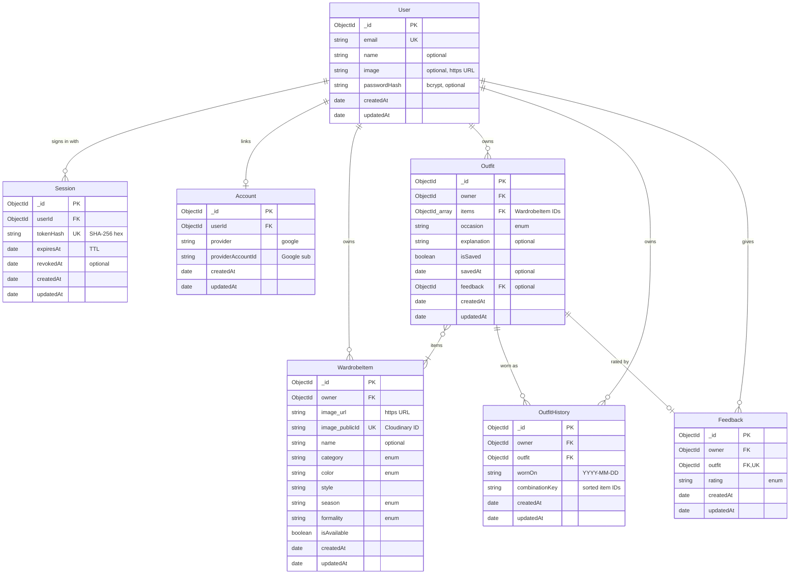

# Database Schema

ReWear AI stores its data in **MongoDB Atlas** through **Mongoose**, in seven collections. Every record belongs to one user, and every query is scoped to the signed-in user. Clothing photos live in **Cloudinary**; MongoDB stores only each image's URL and public ID.

**Legend:** **PK** primary key · **FK** reference to another collection · **UK** unique index. Clothing images are stored in Cloudinary; MongoDB keeps only `image.url` and `image.publicId`.

Mermaid can't show arrays or nested fields, so `items` appears as `ObjectId_array`, and `image.url` / `image.publicId` as `image_url` / `image_publicId`.

The models live in [src/models/](../src/models). Every collection has an `_id` (ObjectId) and Mongoose `createdAt` / `updatedAt` timestamps.

## Relationships

| From | To | Cardinality | Through |
|------|----|-------------|---------|
| User | Session | 1 → 0..* | `Session.userId` |
| User | Account | 1 → 0..1 | `Account.userId` (one Google link per user) |
| User | WardrobeItem | 1 → 0..* | `WardrobeItem.owner` |
| User | Outfit | 1 → 0..* | `Outfit.owner` |
| User | OutfitHistory | 1 → 0..* | `OutfitHistory.owner` |
| User | Feedback | 1 → 0..* | `Feedback.owner` |
| Outfit | WardrobeItem | many ↔ many (1..* items per outfit) | `Outfit.items[]` |
| Outfit | OutfitHistory | 1 → 0..* | `OutfitHistory.outfit` |
| Outfit | Feedback | 1 → 0..1 | `Feedback.outfit` (unique), `Outfit.feedback` |

## Collections

### User
| Field | Type | Rules |
|-------|------|-------|
| `email` | string | Required, unique, lowercased, valid email |
| `name` | string | Optional, max 100 characters |
| `image` | string | Optional, `https` URL |
| `passwordHash` | string | bcrypt hash; `null` for Google-only users; never returned unless selected explicitly |

### Session
| Field | Type | Rules |
|-------|------|-------|
| `userId` | ObjectId → User | Required, indexed |
| `tokenHash` | string | Required, unique, SHA-256 hex (the raw token is never stored) |
| `expiresAt` | date | Required; a TTL index deletes the session once it expires |
| `revokedAt` | date | `null` until sign-out |

### Account
| Field | Type | Rules |
|-------|------|-------|
| `userId` | ObjectId → User | Required |
| `provider` | enum | `google` |
| `providerAccountId` | string | Google's `sub`, not the email |

Google access and refresh tokens are never stored.

### WardrobeItem
| Field | Type | Rules |
|-------|------|-------|
| `owner` | ObjectId → User | Required, indexed |
| `image.url` | string | Required, `https` URL |
| `image.publicId` | string | Required, unique Cloudinary ID (prevents duplicate items on retry) |
| `name` | string | Optional, max 80 characters |
| `category` | enum | Top, Bottom, Outerwear, Dress, Shoes, Accessory |
| `color` | enum | Black, White, Grey, Charcoal, Beige, Camel, Brown, Red, Burgundy, Pink, Orange, Yellow, Green, Blue, Navy, Indigo, Purple, Multicolor |
| `style` | string | Required, max 40 characters |
| `season` | enum | Spring, Summer, Autumn, Winter, All-season |
| `formality` | enum | Casual, Smart casual, Formal |
| `isAvailable` | boolean | Default `true` |

### Outfit
| Field | Type | Rules |
|-------|------|-------|
| `owner` | ObjectId → User | Required, indexed |
| `items` | ObjectId[] → WardrobeItem | At least one, no duplicates; references only, never copied clothing data |
| `occasion` | enum | work, dinner, weekend, casual, formal |
| `explanation` | string | Optional, max 500 characters |
| `isSaved` | boolean | Default `false` |
| `savedAt` | date | Set when the user saves the outfit |
| `feedback` | ObjectId → Feedback | Optional |

### OutfitHistory
| Field | Type | Rules |
|-------|------|-------|
| `owner` | ObjectId → User | Required |
| `outfit` | ObjectId → Outfit | Required |
| `wornOn` | string | Calendar date, `YYYY-MM-DD` |
| `combinationKey` | string | Sorted item IDs, so the same clothes match in any order |

### Feedback
| Field | Type | Rules |
|-------|------|-------|
| `owner` | ObjectId → User | Required, indexed |
| `outfit` | ObjectId → Outfit | Required, unique (one rating per outfit) |
| `rating` | enum | positive, negative |

## Indexes

| Collection | Index | Purpose |
|------------|-------|---------|
| User | `email` (unique) | One user per email |
| Session | `tokenHash` (unique) | Look up a session by its hashed token |
| Session | `expiresAt` (TTL) | MongoDB deletes expired sessions automatically |
| Account | `provider` + `providerAccountId` (unique) | A Google identity belongs to only one user |
| Account | `userId` + `provider` (unique) | A retried sign-in cannot add a second link |
| WardrobeItem | `image.publicId` (unique) | A retried save cannot create a duplicate item |
| Outfit | `owner` + `isSaved` + `savedAt` | Saved Outfits page, newest first |
| OutfitHistory | `outfit` + `wornOn` (unique) | A retried "mark as worn" cannot duplicate a record |
| OutfitHistory | `owner` + `wornOn` + `combinationKey` (unique) | The same clothes on the same day count as one wear |
| OutfitHistory | `owner` + `wornOn` | History view, most recent first |
| Feedback | `outfit` (unique) | Changing feedback updates the one record |
