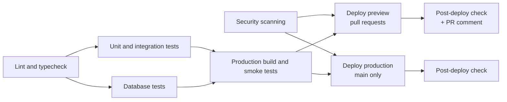

# Setup and Deployment Guide

How to run ReWear AI locally, configure its services, and deploy it to Vercel through the GitHub Actions pipeline. For the data model, see [DATABASE_SCHEMA.md](DATABASE_SCHEMA.md); for the API, see [API.md](API.md).

**Contents:** [Local setup](#local-setup) · [Databases](#databases) · [Tests](#tests) · [CI/CD and deployment](#cicd-and-deployment) · [Troubleshooting](#troubleshooting)

## Local setup

### Prerequisites

| Need | Version or note |
|---|---|
| Node.js | 20.19 or later (Mongoose and `mongodb-memory-server` need it) |
| npm | Comes with Node.js |
| Git | Any recent version |
| MongoDB Atlas | A free cluster |
| Cloudinary | A free account, for clothing photos |
| Google Cloud | Optional, only for Google sign-in |
| Vercel and GitHub | Only for deploying |

### 1. Get the code and install packages

```bash
git clone https://github.com/aarushikaushikk/RewearAI.git
```

```bash
cd RewearAI
```

```bash
npm install
```

`npm install` also downloads the `mongod` binary the database tests use. To skip that download, set `MONGOMS_DISABLE_POSTINSTALL=1` first; `npm run test:db` then downloads it on first use.

### 2. Create your environment file

```bash
cp .env.example .env.local
```

`.env.local` is git-ignored. Never commit it, and never put real values in `.env.example`.

| Variable | Needed for | Local value |
|---|---|---|
| `MONGODB_URI` | Everything | Your Atlas connection string, with `/rewear` as the database (step 3) |
| `APP_ORIGIN` | Google sign-in; required in production | `http://localhost:3000`. Password sign-in also works with it empty |
| `TRUST_PROXY` | Per-client rate limits behind a proxy | `false` |
| `CLOUDINARY_CLOUD_NAME`, `CLOUDINARY_API_KEY`, `CLOUDINARY_API_SECRET` | Uploading clothing photos | From Cloudinary (step 4) |
| `CRON_SECRET` | The daily cleanup of abandoned uploads | A long random string (step 4) |
| `GOOGLE_CLIENT_ID`, `GOOGLE_CLIENT_SECRET` | Google sign-in (optional) | From Google Cloud (step 5) |

### 3. Set up MongoDB Atlas

1. Create a free cluster at [MongoDB Atlas](https://www.mongodb.com/cloud/atlas).
2. Under **Database Access**, add a database user with a strong password.
3. Under **Network Access**, add your IP address.
4. Click **Connect → Drivers** and copy the connection string.
5. Paste it into `MONGODB_URI`, filling in the user, password, and cluster host, and keep `/rewear` as the database name:

   ```
   MONGODB_URI=mongodb+srv://<username>:<password>@<cluster-host>/rewear?retryWrites=true&w=majority
   ```

The app creates its indexes the first time it connects, so an empty database needs no setup or migration.

### 4. Set up Cloudinary

1. Create a free account at [Cloudinary](https://cloudinary.com).
2. Under **Settings → API Keys**, copy the cloud name, API key, and API secret into the three `CLOUDINARY_*` variables.
3. Set `CRON_SECRET` to a long random string. This prints one:

   ```bash
   openssl rand -hex 32
   ```

Without Cloudinary settings the app still runs, but adding clothing fails.

### 5. Set up Google sign-in (optional)

1. In the [Google Cloud Console](https://console.cloud.google.com/apis/credentials), create an OAuth client of type **Web application**.
2. Add this authorized redirect URI, exactly: `http://localhost:3000/api/auth/google/callback`
3. Copy the client ID and secret into `GOOGLE_CLIENT_ID` and `GOOGLE_CLIENT_SECRET`, and set `APP_ORIGIN=http://localhost:3000`.

Without these, the Google button doesn't appear and email/password sign-in keeps working.

### 6. Start the app

```bash
npm run dev
```

Open http://localhost:3000, create an account on the sign-up page, and add a few clothing items from the Wardrobe page.

### Check your work

Run these before opening a pull request, along with the tests in [Running Tests](#tests). CI runs the same ones.

```bash
npm run lint
```

```bash
npm run typecheck
```

## Databases

| Environment | Database |
|---|---|
| Local development and Vercel Preview | `rewear` |
| Vercel Production | `rewear-prod` |
| Tests | A temporary `mongodb-memory-server`, never Atlas |

The database name is the path in `MONGODB_URI`.

## Tests

| Command | What it runs |
|---|---|
| `npm test` | Unit, component, and integration tests (no database) |
| `npm run test:db` | Real-database tests against a temporary MongoDB server, never Atlas |
| `npm run test:smoke` | Builds the app and tests `next start` with real requests |

The database and smoke tests never use your `MONGODB_URI` or Google settings; they start their own temporary MongoDB server and a local fake Google. See [Running Tests in the README](../README.md#running-tests) for details.

## CI/CD and deployment

- **Production:** https://rewear-ai-app.vercel.app
- **Preview (latest PR):** https://rewear-ai-preview.vercel.app

GitHub Actions runs every check and owns every deploy. Vercel's own Git deploys are off (`"git": { "deploymentEnabled": false }` in [vercel.json](../vercel.json)), so nothing reaches Vercel unless the whole pipeline has passed.

### Pipeline

[.github/workflows/ci.yml](../.github/workflows/ci.yml) runs on every pull request to `main` and every push to `main`. A newer run on the same branch cancels an older one.



| Stage | Job | What it does |
|---|---|---|
| 1. Quality | Lint and typecheck | `npm run lint`, `npm run typecheck` |
| 2. Tests | Unit and integration tests | `npm test` (Vitest; `MONGODB_URI` is forced empty, so it can't reach a real database) |
| 2. Tests | Database tests | `npm run test:db` against a temporary `mongodb-memory-server`, cached between runs |
| 3. Build | Production build and smoke tests | `npm run test:smoke`: `next build`, then HTTP and real-Chrome checks against the built app and a temporary database. Fails if any `/api` route isn't dynamic (`ƒ`) |
| Security | Security scanning | `npm audit` of production dependencies (fails on high), GitHub dependency review on PRs (fails on high), and a gitleaks secret scan of the full history |
| Security | CodeQL ([codeql.yml](../.github/workflows/codeql.yml)) | `security-extended` analysis of the TypeScript code on PRs, on pushes to `main`, and weekly. Results appear under Security → Code scanning |
| 4. Deploy | Deploy preview | PRs only. `vercel pull`, `vercel build`, `vercel deploy --prebuilt`, then points the fixed preview domain at the new deployment and comments both URLs on the PR |
| 4. Deploy | Deploy production | Pushes to `main` only, one at a time. Same steps with `--prod` |
| 5. Verify | Post-deploy check | [scripts/checkDeployment.sh](../scripts/checkDeployment.sh): `/sign-in` must return 200 and `/api/auth/session` must not return a 5xx |

[Dependabot](../.github/dependabot.yml) opens weekly PRs for npm and GitHub Actions updates. Major versions are ignored, because AGENTS.md requires both partners to agree to those.

The third-party gitleaks action is pinned to a full commit SHA, with its version in a comment, because a tag can be moved to different code. Dependabot updates the pin. GitHub's own `actions/*` use version tags.

### Reading a run

- **Summary:** each run's page (Actions → the run) lists the test counts for each suite and, after a deploy, its URL and database.
- **Diagnostics:** if the build and smoke tests fail, the run has a `smoke-diagnostics` artifact (kept for 7 days) with the full build output and the browser screenshots taken so far.
- **Timeouts:** every job has a `timeout-minutes` limit (10–20 minutes), so a hung browser or database stops in minutes instead of GitHub's 6-hour default.

### Environments

| Environment | Where it runs | Config | Database |
|---|---|---|---|
| Development | `npm run dev` | `.env.local` | `rewear` |
| Test | Vitest and CI | Set by the test configs | Temporary `mongodb-memory-server`, never Atlas |
| Preview | Vercel Preview, one deploy per PR push | Vercel Preview environment variables | `rewear` (holds the seeded test account) |
| Production | Vercel Production, every merge to `main` | Vercel Production environment variables | `rewear-prod` |

Preview and Production are also GitHub Environments, so each deploy is listed on the repository's Deployments page with its URL.

Preview and Production use the same Atlas cluster and user, with different databases. The app creates its indexes when it connects, so a new, empty database needs no migration.

`APP_ORIGIN` must be one exact origin (sign-in refuses any other). Each preview deploy has its own URL, so the pipeline also points a fixed domain, `PREVIEW_DOMAIN`, at the latest preview, and Preview's `APP_ORIGIN` is that domain. Sign in through the domain in the PR comment, not the per-deployment URL. The latest PR push takes over the domain.

### Settings the pipeline needs

| Name | Kind | Value |
|---|---|---|
| `VERCEL_TOKEN` | GitHub secret | A Vercel access token |
| `VERCEL_ORG_ID` | GitHub secret | `orgId` from `.vercel/project.json` |
| `VERCEL_PROJECT_ID` | GitHub secret | `projectId` from `.vercel/project.json` |
| `PREVIEW_DOMAIN` | GitHub variable | e.g. `rewear-ai-preview.vercel.app` |
| `PRODUCTION_URL` | GitHub variable | e.g. `https://rewear-ai-app.vercel.app` |

A deploy job fails with a message naming any of these that is missing.

### One-time setup

1. Log in and create the Vercel project from the repository root:
   ```bash
   npx vercel@65.2.0 login
   ```
   ```bash
   npx vercel@65.2.0 link
   ```
   Choose to create a new project. This writes `.vercel/project.json`, which is gitignored.
2. Choose two unused `*.vercel.app` names: one for production (e.g. `rewear-ai-app.vercel.app`) and one for previews (e.g. `rewear-ai-preview.vercel.app`). You don't add them in the dashboard: each deploy job points its domain at the new deployment through the Vercel API ([scripts/setVercelAlias.sh](../scripts/setVercelAlias.sh)).
3. In Vercel → Project → **Settings → Environment Variables**, add each variable below. For each one, untick **Development**, and tick **Preview** or **Production** only, as shown. Copy the values from `.env.local`; never commit them.

   | Variable | Preview | Production |
   |---|---|---|
   | `MONGODB_URI` | The value from `.env.local` (database `rewear`) | The same value, with the database path `/rewear` changed to `/rewear-prod` |
   | `APP_ORIGIN` | `https://<preview domain>` | `https://<production domain>` |
   | `TRUST_PROXY` | `true` | `true` |
   | `MONGOMS_DISABLE_POSTINSTALL` | `1` | `1` |
   | `CLOUDINARY_CLOUD_NAME`, `CLOUDINARY_API_KEY`, `CLOUDINARY_API_SECRET` | From `.env.local` | From `.env.local` |
   | `CRON_SECRET` | From `.env.local` | From `.env.local` |
   | `GOOGLE_CLIENT_ID`, `GOOGLE_CLIENT_SECRET` | From `.env.local`, if set | From `.env.local`, if set |

   Changes apply to the next deploy, so after editing a variable, rerun the deploy job.
4. In GitHub → **Settings → Secrets and variables → Actions**:
   - **Secrets** tab: add `VERCEL_ORG_ID` and `VERCEL_PROJECT_ID`, using `orgId` and `projectId` from `.vercel/project.json`.
   - **Variables** tab: add `PREVIEW_DOMAIN` (e.g. `rewear-ai-preview.vercel.app`, no `https://`) and `PRODUCTION_URL` (e.g. `https://rewear-ai-app.vercel.app`).
5. Create a token at Vercel → Account Settings → Tokens, then paste it when prompted:
   ```bash
   gh secret set VERCEL_TOKEN
   ```
6. In Vercel → Project → Settings → Deployment Protection, turn off Vercel Authentication. Otherwise previews return 401 to the post-deploy check, your partner and the graders.
7. In the Google OAuth client, add both redirect URIs: `https://<production domain>/api/auth/google/callback` and `https://<preview domain>/api/auth/google/callback`.
8. In Atlas → Network Access → IP Access List, add `0.0.0.0/0` (not temporary). Vercel's servers have no fixed IP addresses; the database user and password still protect the cluster.
9. After the first green run, protect `main` (Settings → Branches): require a pull request with one approval, and require the checks Lint and typecheck, Unit and integration tests, Database tests, Production build and smoke tests, Security scanning, and CodeQL.

### Verify a deploy

The pipeline checks that `/sign-in` loads and `/api/auth/session` doesn't fail. After a production deploy, also check by hand:

- [ ] Sign up, sign out, and sign in again with email and password
- [ ] Sign in with Google, if it's configured
- [ ] Add a clothing item with a photo; it appears in the wardrobe
- [ ] Reload the page and sign in again; the item is still there
- [ ] Generate an outfit, then save it and mark it as worn; it appears on Saved Outfits and History

### Roll back

In Vercel → Deployments, open an earlier production deployment and choose **Promote to Production**. Then revert the bad commit on `main` through a PR, so the next deploy doesn't bring it back.


## Troubleshooting

| Problem | Likely cause and fix |
|---|---|
| Sign-up, sign-in, or sign-out returns 403 | `APP_ORIGIN` doesn't match the address in the browser exactly. Use the fixed domain, not a per-deployment Vercel URL |
| "We couldn't reach the database" | Atlas **Network Access** doesn't allow your IP (or `0.0.0.0/0` for Vercel), or `MONGODB_URI` has the wrong user or password |
| The Google button is missing | `GOOGLE_CLIENT_ID` or `GOOGLE_CLIENT_SECRET` isn't set |
| Google says `redirect_uri_mismatch` | The OAuth client is missing `<APP_ORIGIN>/api/auth/google/callback` for this environment |
| Adding clothing fails | A `CLOUDINARY_*` variable is missing or wrong. Photos must be JPEG, PNG, or WebP, up to 4 MB |
| The cleanup route refuses requests | `CRON_SECRET` isn't set in that Vercel environment |
| Previews return 401 | Vercel Authentication is still on under Deployment Protection |
| A changed Vercel variable has no effect | Variables apply to the next deploy. Rerun the deploy job |

